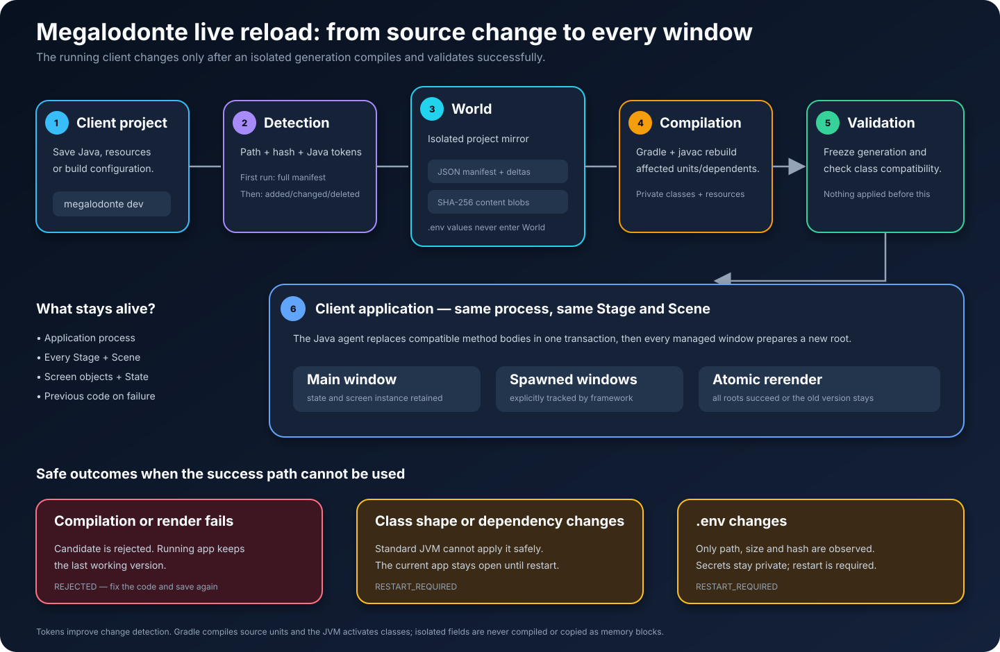

# Megalodonte CLI

Create desktop, Android, and Roku applications with Megalodonte. Desktop and Android support declarative JSONC views (`jsonc`) and Java screens (`native`). Roku initially supports Java-authored native screens: Java runs at build time and produces SceneGraph XML and BrightScript for the TV. The CLI generates a Gradle build, wrapper, starter screen, GitHub Actions workflow, icon, and local Git repository. Desktop projects also receive AppImage, DEB and MSI packaging.

## Install

Requires Python 3.11 or later. From this repository, install the CLI in an isolated environment:

```sh
pipx install --editable .
```

For a non-editable install, use `pipx install .`. An editable install immediately exposes updates made in this checkout. A Python virtual environment with `pip install -e .` also works.

### Why the `megalodonte` command exists

The command name is declared by the package in `pyproject.toml`:

```toml
[project.scripts]
megalodonte = "megalodonte_cli.cli:main"
```

When `pipx` installs the package, it creates a small executable launcher named
`megalodonte` in its binary directory (normally `~/.local/bin`). That directory
must be present in `PATH`; `pipx ensurepath` configures it when necessary. The
launcher imports `megalodonte_cli.cli.main`, which interprets the next argument as
a command. This is why `megalodonte dev`, `megalodonte skills sync`, and the normal
project-generation options all begin with the same executable name.

Check which installation your shell is using with:

```sh
command -v megalodonte
megalodonte --help
```

An installation made inside a regular Python virtual environment exposes the
command only while that environment is active, unless its `bin` directory is
added to `PATH` separately.

## Develop with live reload

From an existing native desktop application, use `megalodonte dev --project .`
(`--offline` uses cached dependencies). The CLI watches source and resource
changes, debounces saves, compiles incrementally with Gradle in a temporary world,
and sends complete successful generations to the running JVM. The first build
records a JSON manifest of project files, Java tokens/symbols and hashes; later
builds record only deltas. File contents use a local content-addressed store, so
binary resources are not inflated into JSON. Compiler responses contain status
and output artifact hashes rather than retransmitting the entire application.
The normal project
`build/` and running dependency JARs are not overwritten. All visible windows
registered through `Context` or `ScreenManager` rerender with the same screen
instances. Logs report applied class/window counts and failures.

Install matching updated `megalodonte-core`, `megalodonte-base`, and, if used,
`megalodonte-reactivity` artifacts first. This currently supports single-project,
non-modular native desktop applications using Gradle's `application` plugin.

Composite dependencies (`includeBuild`) are supported. The init script targets
only the supervised application's canonical directory; included libraries keep
their own build outputs and are frozen as dependencies when the app starts.
Gradle keeps its per-build `.gradle` caches; only the application's compiled
output and runtime generations move to the temporary world.
Library source changes are not watched automatically: stop/start the session to
rebuild and load them. The application itself must still be single-project. See
[docs/live-reload-known-limitations.md](docs/live-reload-known-limitations.md)
for the composite-build fix, validation and remaining limits.

Failed compilation keeps the application running. Compatible method-body edits
retain the JVM, screen instances and managed windows. Structural changes such as
new component factories, imports that introduce new classes, fields, methods or
signatures, and dependency changes automatically restart the application child so
the successful generation becomes visible. That fallback recreates windows and
loses in-memory state; use `--no-restart-on-incompatible` only when keeping the old
generation active is preferable. Ctrl+C ends the development session.
`--debounce 0.8` changes the quiet interval in seconds.

This does not copy raw memory, reinitialize existing objects, migrate arbitrary
state, or update cached JSONC views. For the full supported-change matrix and
rollback limits, see the [base live reload guide](https://github.com/eliezer-dev-software-enginner/megalodonte-base/blob/main/docs/LIVE_RELOAD.md).
Environment-file values are never placed in protocol JSON; changing `.env`
requires restarting the development session. Java token comparison detects the
smallest source difference, while javac still compiles class/source units and
affected dependents. Tokenization cannot bypass JVM class-shape restrictions.



Validate the CLI with `PYTHONPATH=src python -m unittest discover -s tests`.

### Experimental persistent native windows

This is a separate experiment, not the project-to-compiler messaging described
above. It should not be inferred as automatic serialization of an existing app.

For Java workers explicitly using `NativeWorker.Application` from the updated
base library:

```sh
megalodonte dev --native-host --worker-main your.package.WorkerMain
```

This keeps a permanent JavaFX host and replaces worker JVMs after successful
builds, including class additions/removals and structural changes. It does not
adapt ordinary application Main classes or existing component trees automatically.
JSON is internal messaging; application code remains Java. The current prototype
supports text, buttons, inputs, rows and columns; stable input IDs retain edited
text, while arbitrary business state requires explicit migration.

Host runtime changes require a manual stop/start; this mode never automatically
restarts the host. Rejected candidates keep the previous worker and windows.
Generation files remain until the session ends. Closing any window ends the
prototype host session. See the [native messaging design and API](https://github.com/eliezer-dev-software-enginner/megalodonte-base/blob/main/docs/NATIVE_MESSAGING.md).

Explicit integration check (display and published artifacts required):
`PYTHONPATH=src python tests/integration_native_host.py`.
The opt-in `PYTHONPATH=src python tests/integration_live_reload.py` additionally
requires JDK 25, local artifacts, Gradle dependencies and a display, and exercises
a temporary generated consumer without touching user projects.

## Create an application

From the desired parent directory:

```sh
megalodonte my-app --mode jsonc --display-name "My App"
megalodonte another-app --mode native
megalodonte phone-app --platform android --mode native
megalodonte phone-jsonc --platform android --mode jsonc
megalodonte roku-hello-world --platform roku --mode native --display-name "Megalodonte Roku Hello"
```

On desktop, `jsonc` creates a declarative starter view and a Java `ViewScript`; `native` creates a Java screen composed from Megalodonte components. On Android, `native` creates a `ScreenComponent`; `jsonc` stores the view under `app/src/main/assets/views/` and renders it through the Android bridge. See the [Android component guide](https://github.com/eliezer-dev-software-enginner/megalodonte-android/blob/main/docs/JSONC_ANDROID.md) for supported components, behavior, and property differences from desktop. The project is created in `./my-app` (or the chosen `--output-root`). The CLI also runs `git init`, so Git must be available. Names must start with a lowercase letter and may contain lowercase letters, digits, and single hyphens between groups; `--mode` is required. Desktop builds target Java 25 and JavaFX 25.0.1. To test and launch a desktop project:

Native desktop starters register their bundled icon and use an application-specific JavaFX host, so Linux docks can match the running window to its own icon.

The native starter uses this pattern in `Main.java`:

```java
import megalodonte.application.MegalodonteApp;
import megalodonte.application.MegalodonteApplication;
import megalodonte.base.theme.ThemeManager;

public final class Main {
    public static final class AppHost extends MegalodonteApplication {}

    static void main(String[] args) {
        ThemeManager.setTheme(new MyTheme());
        MegalodonteApp.appName("My App");
        MegalodonteApp.appIcon("/icon.png");
        MegalodonteApp.run(AppHost.class, args, context -> {
            context.javafxStage().setMinWidth(980);
            context.javafxStage().setMinHeight(650);
            context.useView(new HomeScreen(), 1260, 780);
        });
    }
}
```

`MyTheme` and `HomeScreen` stand for your theme and screen classes; keep any
additional startup logic your application needs. The generated starter uses
`DefaultTheme` and can use its default window dimensions.

If Linux shows the wrong dock icon, check `appName`, `appIcon`, the application's
own `AppHost` and the `StartupWMClass` of its `.desktop` entry. On X11, run
`xprop WM_CLASS` and click the window to inspect its actual class. Development
entries are written under `~/.local/share/applications/` and refer to an icon
whose filename contains a content hash. Rebuild and restart after source changes;
rebuild and reinstall packaged applications. Dock behavior and Wayland
diagnostics vary by desktop environment.

For JSONC starters, set `app.icon=/icon.png` in `application.properties` to
configure the window icon. The shared JSONC launcher currently uses a shared
JavaFX host, so a unique dock icon is not guaranteed by this setting alone;
an application-specific Java entry point is needed for the host-based approach.

```sh
cd my-app
./gradlew test
./gradlew run
```

## Agent skills

Every generated desktop, Android or Roku project includes `skills/megalodonte-native-ui/SKILL.md` for interfaces and `skills/criterioso/SKILL.md` for investigation, implementation and validation. `AGENTS.md` explains when to read each skill. Copies are versioned with the project; the CLI bundles the canonical versions, so new projects receive the installed CLI's skills.

To make the skills available in Codex's `$` menu, run from the project root:

```sh
megalodonte skills install --project .
```

This creates links in `~/.codex/skills` (or `$CODEX_HOME/skills`) to both project skills. If a name already points elsewhere, the CLI reports the conflict without replacing it. After updating the CLI, refresh an existing project with `megalodonte skills sync --project .`; the links follow the updated files. Synchronization replaces the project copies, so keep project-specific customizations separately. Start a new conversation if the `$` menu does not refresh immediately.

Invoke `$criterioso` for general development or `$megalodonte-native-ui` for UI work. Instructions in `AGENTS.md` also make the appropriate skills applicable without explicit invocation.

Gradle needs a Java 25 toolchain. The wrapper may download Gradle, and the build needs its Megalodonte dependencies from Maven local, Maven Central, or the local workspace builds described below.

For local Linux AppImage packaging, install the separate `megalodonte-packaging` Python library, then run `python3 scripts/package.py build appimage` from the generated project. The generated packaging script can also locate that library's source in a sibling `framework/megalodonte-packaging/src` directory, or via `MEGALODONTE_PACKAGING_HOME` pointing to its repository root. The generated GitHub Actions caller invokes the shared `megalodonte-packaging` workflow to build AppImage, DEB, and MSI installers on a `v*` tag or manual dispatch; configure a GitHub remote before pushing a tag.

Inside `megalodonte-world`, pass `--output-root applications --workspace .` to register the new app in `workspace.toml` and include the framework's local source builds. Outside the workspace, the generated Gradle build uses published dependencies from Maven local or Maven Central. The workflow uses the shared `megalodonte-packaging` reusable workflow.

## Android projects

Android projects target API 35 and default to a minimum of API 35. For older TV boxes, pass `--min-sdk 25` (Android 7.1). The bridge handles legacy system insets and the generated app enables Java library desugaring. They compile Java 17 source. Install JDK 25 and Android SDK Platform 35. The project uses the source modules in `megalodonte-android` and the shared core, theme and portable reactivity libraries. Outside `megalodonte-world`, place the source checkouts relative to the generated project as follows:

```text
my-app/
  framework/
    megalodonte-android/
    libraries/
      megalodonte-core/
      megalodonte-theme/
      megalodonte-reactivity-portable/
```

Alternatively, set `MEGALODONTE_ANDROID_HOME` to the `megalodonte-android` checkout; its sibling `libraries/` directory must still contain the three shared library checkouts. From the generated project, run:

```sh
./gradlew :app:assembleDebug :app:lintDebug
```

The debug APK is `app/build/outputs/apk/debug/app-debug.apk`. The generated workflow checks out these sources and uploads a debug APK. Android projects do not use JavaFX or desktop packaging.

## Roku

`--platform roku --mode native` generates a Java `HomeScreen` using
`megalodonte-roku`. The generated build requires a Java 25 toolchain and a
checkout of `megalodonte-roku`. Outside this workspace, place the checkout at
`framework/megalodonte-roku` relative to the generated project, or set
`MEGALODONTE_ROKU_HOME` to its path. From the generated project directory, run
`./gradlew packageRoku`; the result is `build/roku/<project>.zip`, ready for Roku
Developer Mode sideloading. The starter demonstrates three routes, unprefixed
`Button`, `Text`, and `Counter` components, a build-time `Theme` palette, and a
runtime counter. `Image` is available for local PNG/JPEG assets. Arbitrary Java
code and desktop/Android component implementations cannot run on Roku. The
generated BrightScript can be checked with the BrighterScript CLI (`bsc`).

## Development

```sh
PYTHONPATH=src python3 -m unittest discover -s tests -v
```

Keep the generated workflow aligned with `megalodonte-packaging/tools/configure_client_actions.py` when the shared packaging contract changes.

The repository's GitHub Actions workflow tests the installed command and checks that its bundled Gradle wrapper and packaging assets are present. Local end-to-end validation on 2026-10-15 also compiled newly generated JSONC and native applications using the workspace composite builds (`./gradlew test --offline` in each generated application).

## License

No license file is included in this repository. Usage and redistribution terms need confirmation from the project owner.
